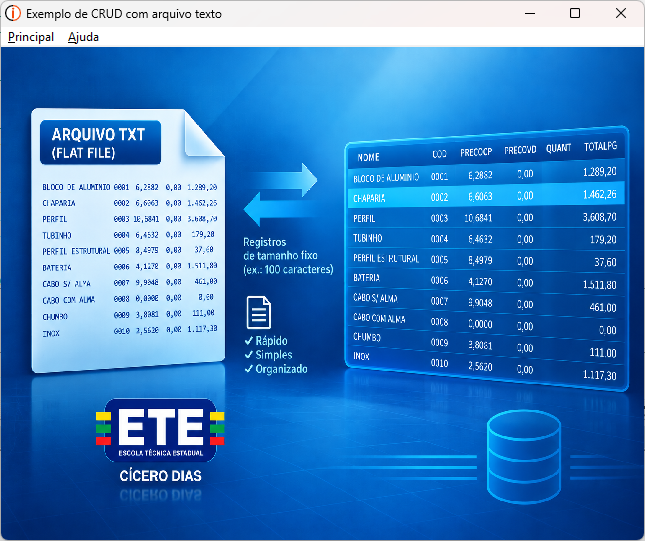
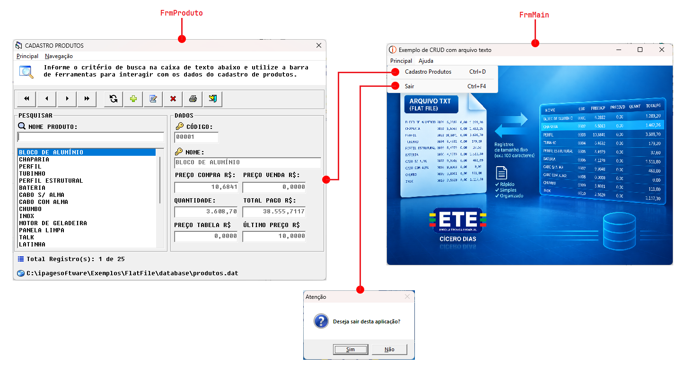
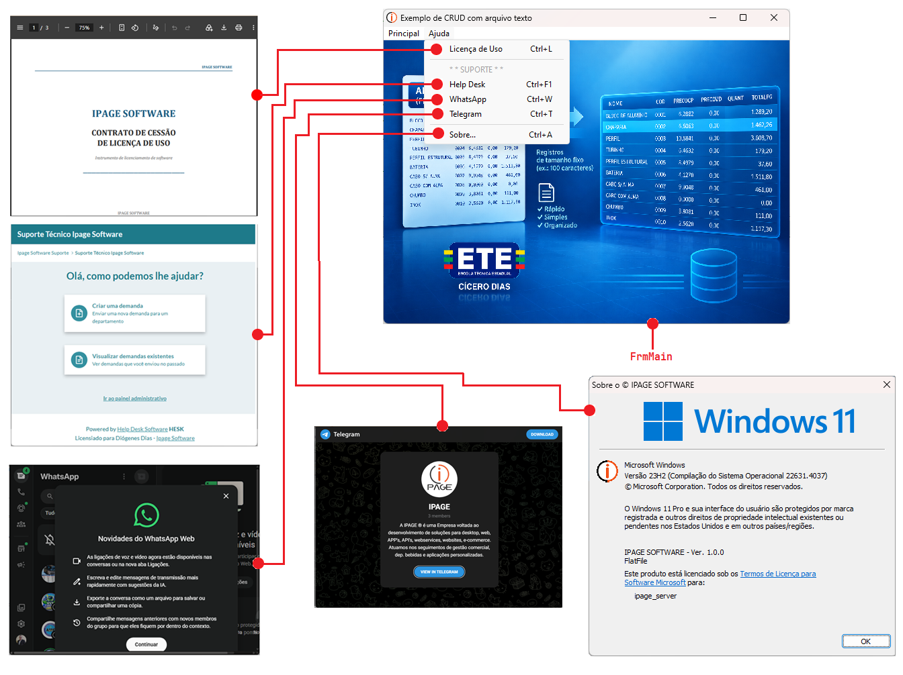
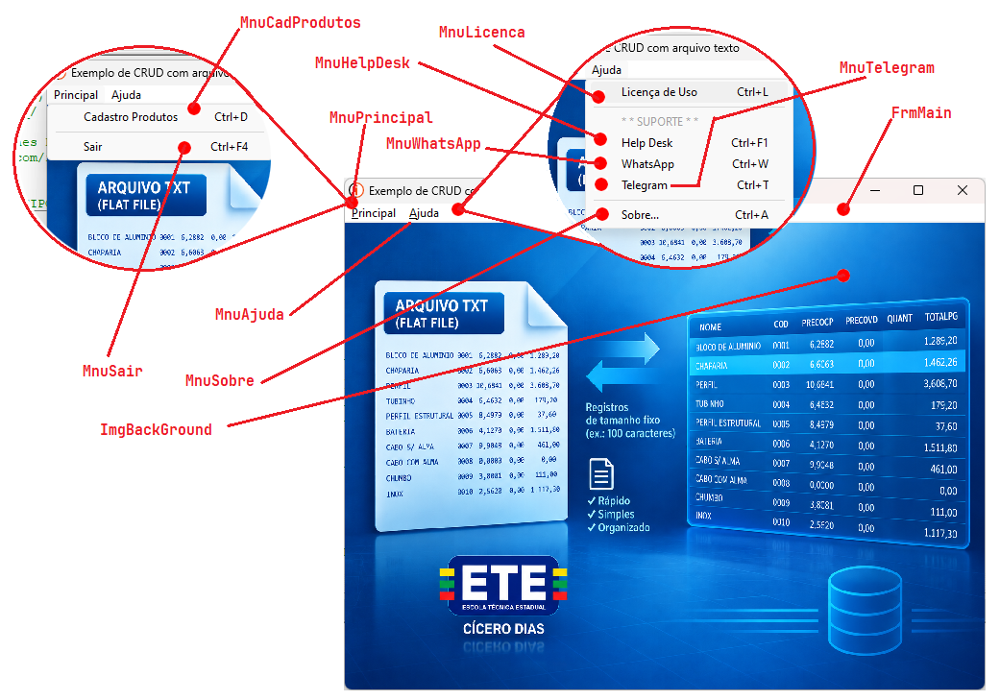
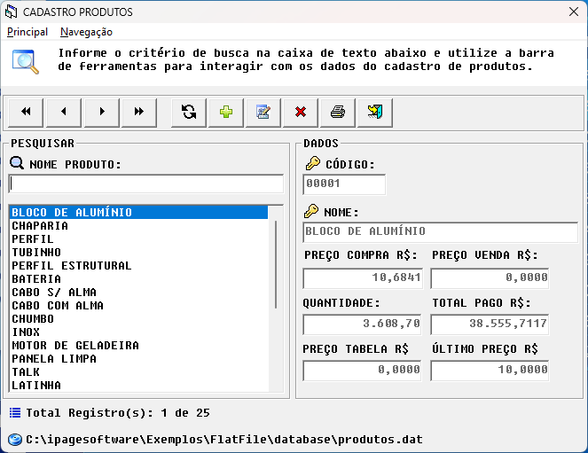
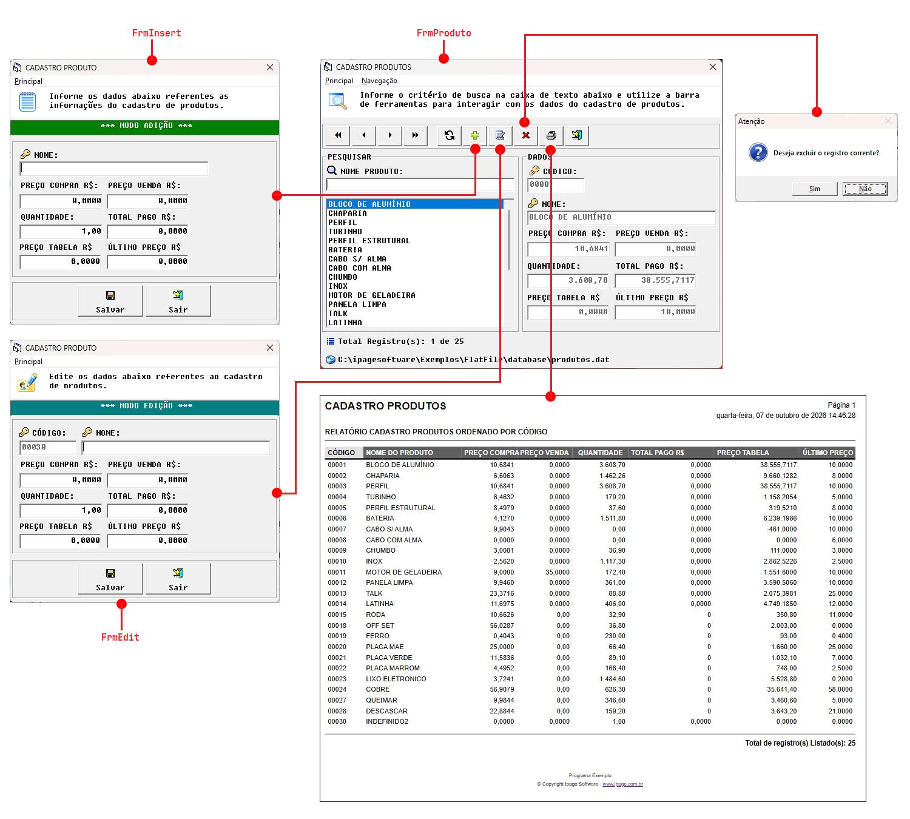

# Documentação da Tela — Cadastro de Produtos (Ver. 1.0)

> **Descrição funcional dos componentes de um CRUD de produtos.**

## TELA PRINCIPAL

---

## 📌 Objetivo da Tela Principal
A tela **Principal (FrmMain)** possui os menus **Principal** e o menu **Ajuda**

Ela permite:
* Chamar o **Cadastro de Produtos**
* Encerrar a operação
* Acesso ao menu **Ajuda**

---

## Visão Geral dos Componentes da Tela Principal e Seus Respectivos Nomes

---
-

## Tela Cadastro de Produtos

---

## Objetivo da Tela

A tela de **Cadastro de Produtos** é um CRUD (*Create, Read, Update e Delete*) destinado ao cadastro e à manutenção de produtos.

---

Ela permite:
* Localizar registros existentes
* Navegar entre os registros
* Incluir novos produtos
* Alterar dados
* Excluir registros
* Imprimir informações
* Encerrar a operação

---

## Fluxo de Utilização do CRUD

1. **Pesquisar:** O usuário informa o nome do produto no campo `NOME PRODUTO`.
2. **Localizar:** A lista apresenta os produtos compatíveis com o critério informado.
3. **Selecionar:** O usuário seleciona um produto na lista.
4. **Visualizar:** Os campos da área `DADOS` são preenchidos com as informações do registro selecionado.
5. **Navegar:** Os botões *Primeiro*, *Anterior*, *Próximo* e *Último* permitem percorrer os registros.
6. **Incluir:** O botão *Novo* inicia o cadastro de um produto.
7. **Alterar:** O botão *Alterar* permite modificar o produto selecionado.
8. **Excluir:** O botão *Excluir* remove o registro, preferencialmente com confirmação.
9. **Atualizar:** O botão *Atualizar/Recarregar* sincroniza a tela com a fonte de dados.
10. **Imprimir:** O botão *Imprimir* gera a saída impressa ou relatório correspondente.

---

## Estrutura Lógica Sugerida do CRUD

A tela é organizada conceitualmente em quatro grupos de operações:

* **CREATE (Criar):** Novo cadastro de produto.
* **READ (Ler):** Pesquisa, listagem, seleção e visualização dos produtos.
* **UPDATE (Atualizar):** Alteração dos dados do produto selecionado.
* **DELETE (Excluir):** Exclusão do produto selecionado.

---

## Observações Sobre a Implementação

* **Base de Dados em Arquivo:** A aplicação utiliza armazenamento via arquivo plano, conforme indicado na barra de status: `C:\ipagesoftware\Exemplos\FlatFile\database\produtos.dat`.
* **Mecanismo de Seleção:** A lista de produtos funciona como seleção dos registros, enquanto o painel `DADOS` apresenta os campos do item selecionado.
* **Tratamento no VB6 (ListBox ItemData):** Numa implementação em Visual Basic 6.0, o parâmetro `ItemData` da `ListBox` é utilizado para armazenar o código/ID do produto. Dessa forma, o texto exibido mostra o nome do produto enquanto `ItemData` mantém a identificação numérica para localização, alteração ou exclusão correta no banco.

